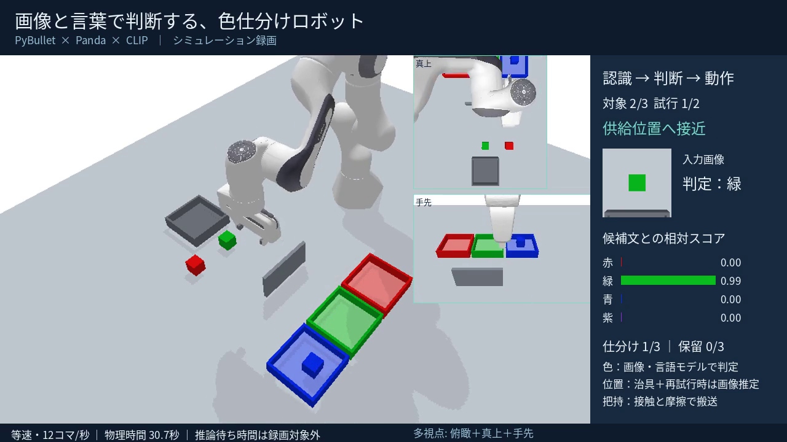
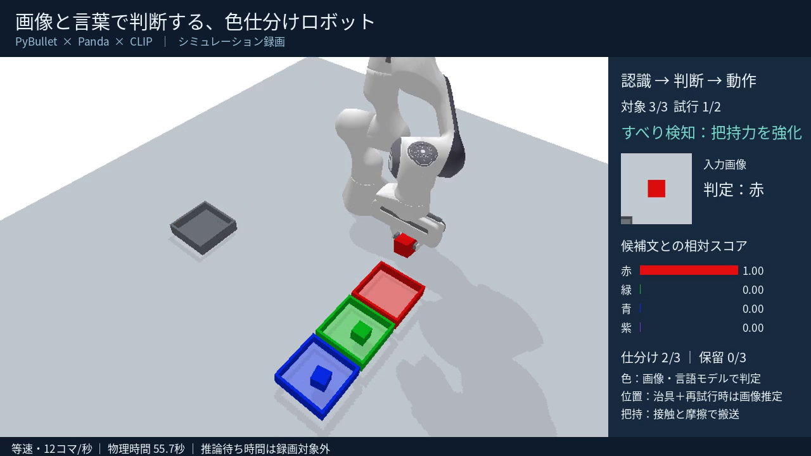

# 画像と言葉で判断する 色仕分けロボット

CLIP × PyBullet × Panda 7軸 — カメラ画像と言語候補を照合して色を判定し、判定した色の回収皿へ立方体を搬送するロボットのシミュレーション。把持失敗の検知と再試行、すべり検知、障害物越え、多視点録画を実装している。

本リポジトリは PAI最終課題 の提出物の一部。実験はすべてシミュレーション（PyBullet）内で完結し、実機は扱わない。

## デモ

| 多視点録画（俯瞰＋真上＋手先） | すべり検知による把持力の強化 |
|---|---|
|  |  |

- 提出動画（YouTube・限定公開）: 【投稿後にここへURLを追記】
- 動画は物理時間で等速。推論待ちの実時間は録画対象外。

## 実装している機能

- **CLIPによる色判定**: 各供給位置のカメラ画像と候補文（赤・緑・青・紫の `a photo of a … cube`）を照合し、最も近い候補を判定として採用。候補間照合型であり、自由回答型の対話モデルではない。
- **保留判断**: 予測が未知色（紫）か候補間差がしきい値未満の場合、仕分けを保留し中立色の保留皿へ搬送する。
- **接触・摩擦による把持**: 物体の移動は接触と摩擦のみ。瞬間移動や固定拘束（createConstraint）は使わない。
- **失敗検知と上限付き再試行**: 持ち上げ後、両指の接触と高さを0.1秒間隔で3回確認。失敗時は開放・退避し、治具付近に残っていれば治具へ、離れていれば画像推定の位置へ再接近する（上限あり）。
- **画像位置推定**: 真上カメラのHSV色付き塊の重心から物体位置を推定し、再接近先の決定だけに使用。初回の供給位置は既知治具のまま。
- **すべり検知と把持力の安定化**: 持ち上げ・搬送中の高さ低下を監視し、すべりを検知すると把持力を1.6倍ずつ強化（上限2.5倍）。
- **障害物越え**: `--wall` で供給列と回収皿の間に低い壁を置き、経由点を挟む2段階搬送に切り替える。
- **自動試験**: 故障注入・低摩擦・照度変更などの条件で再試行なし／ありを比較する統計付き試験スイート。
- **多視点録画**: `--multi-view` で俯瞰＋真上＋手先追従の3視点を合成し、日本語の状態表示を各フレームへ描画する。

## システム構成

| 構成要素 | 採用技術 | 役割 |
|---|---|---|
| 物理シミュレーション | PyBullet 3.2.7 | テーブル、Franka Panda 7軸アーム、立方体、回収皿の物理演算 |
| 認識 | CLIP（openai/clip-vit-base-patch32） | カメラ画像と候補文の照合による色判定 |
| 制御 | 逆運動学＋関節位置制御 | 手先の目標座標から関節角度を算出し位置制御 |
| 位置推定 | OpenCV（HSV＋連結成分） | 真上カメラからの物体位置推定（失敗後の再接近専用） |
| 記録・録画 | Pillow＋ffmpeg | 等速MP4の生成と日本語字幕の合成 |

## セットアップ

推奨環境: Python 3.11・Linux（検証環境はCPUのみ）。ffmpeg（録画時のみ）と日本語フォントが必要。

```bash
python3.11 -m venv .venv
source .venv/bin/activate

# CPU用のPyTorchを先に導入
python -m pip install torch==2.9.0 --index-url https://download.pytorch.org/whl/cpu
python -m pip install -r requirements.txt

# ffmpeg（Linuxの例）
sudo apt-get install ffmpeg fonts-noto-cjk
```

初回実行時にHugging FaceからCLIPの重みを取得する（リポジトリには含めない）。

## 使い方

```bash
# 本番録画（字幕付きMP4を生成）
python run_sorting.py --output output

# 多視点・障害物越えの録画
python run_sorting.py --multi-view --wall --output wall_video

# すべり検知が発火しやすい条件（弱い把持力）
python run_sorting.py --grip-force 3 --multi-view --output slip_video

# 故障注入（各物体の初回だけ指が閉じない）→ 再試行での回復
python run_sorting.py --fault first-open --max-attempts 2 --output retry_video

# 未知色（紫）を含む色配置 → 保留判断
python run_sorting.py --colors red,purple,green --output hold_video

# 録画なしの物理動作試験
python run_sorting.py --no-video --output smoke_test

# 統計付き自動試験（4条件 × repeats回 × 3物体）
python test_suite.py --output stats_suite --repeats 3

# 校正プローブ（候補間差と位置推定精度の測定）
python calibration_probe.py

# 単体試験（12件）と出力検査
python -m unittest test_logic -v
python verify_output.py --output output
```

### 主なオプション

| オプション | 既定 | 説明 |
|---|---|---|
| `--max-attempts N` | 2 | 初回を含む総把持回数（1〜4） |
| `--fault` | none | 試験用の故障注入（first-open / always-open） |
| `--colors` | red,green,blue | 供給する3物体の色（purpleを含められる） |
| `--hold-margin` | 0.5 | 候補間差がこの値未満なら保留 |
| `--grip-force` | 35.0 | 指のモーター力の上限 |
| `--finger-friction` / `--object-friction` | 2.0 / 1.5 | 摩擦係数 |
| `--light-level` | 1.0 | 認識用カメラの光の色成分（0.1〜1） |
| `--multi-view` | off | 俯瞰＋真上＋手先の3視点合成録画 |
| `--wall` | off | 障害物越え（壁＋経由点経路） |
| `--no-estimate` | off | 再試行時の画像位置推定を無効化 |

実行ごとに `result.json` へ設定・推論・物理結果・失敗理由が記録される。詳細は `使い方.txt` を参照。

## 検証結果

### 故障注入に対する再試行の効果

各条件・各方策1回、各回3物体。成功率の推定値ではない。

| 条件 | 再試行なし | 再試行あり | 備考 |
|---|---|---|---|
| 通常（色順固定） | 3/3 | 3/3 | 再試行は発生しない |
| 色順を変更 | 3/3 | 3/3 | 同上 |
| 初回だけ指が閉じない故障 | 0/3 | 3/3 | 3個すべて再試行で回復 |
| 指が閉じない故障が継続 | 0/3 | 0/3 | 試行上限で安全に停止 |
| 低摩擦（0.4） | 1/3 | 1/3 | 押し出された2個は回復できず |
| 認識カメラの光を下げる | 3/3 | 3/3 | 今回の範囲では分類に影響なし |

### 校正プローブの実測（`results/calibration_probe.json`）

- 候補間差: 通常光0.989／薄暗光0.974／紫0.922／薄暗光＋紫0.972。紫は予測 `purple` となり保留判断につながる。
- 位置推定: ずれ0〜6cmの5条件で推定成功、最大誤差5.2mm。探査範囲は治具中心±9cm。
- すべり検知: 把持力3N条件で搬送中に9mmの高さ低下を検知し、把持力1.0倍→1.6倍へ強化して仕分けを継続（3/3）。

### 実測された否定的結果

- 低摩擦0.4では、把持の閉じる段階で立方体が指の間から押し出され、再把持でも回復できなかった（把持力を弱くしても改善せず）。すべり検知は「保持できたあとの滑り」に有効で、押し出しの予防には使えなかった。
- 押し出しで供給位置から約19cm離れた物体は、位置推定の探査範囲±9cmの外に出るため、見つけられず安全停止した。
- 把持力を弱いまま（3N）壁越えの長い搬送を行うと、保持を失ってすべて失敗した。壁越えには通常の把持力が必要だった。

## 限界

- 位置推定は真上カメラ・平面・離隔配置が前提の古典的な画像処理であり、深層学習の物体検出ではない。
- 保留のしきい値0.5は、今回の条件では発火例がなく安全網扱い（保留の発火は未知色の候補経由で確認）。
- 各条件・各方策1回〜3回、各回3物体の小規模試験であり、成功率の推定や実機での性能ではない。
- 実機・実照度・実摩擦は未検証。照明、未知物体、姿勢変化への汎化は確認していない。

## AIの活用範囲（開示）

本リポジトリの作成では、設計相談・コード作成支援・検証の自動化・資料の骨子作成にAIを使用した。動作確認・数値の突合・最終判断は提出者が行った。講座の方針に従い、理解していないコードや文章をそのまま提出しないこと。

## リポジトリ構成

```
robot-color-sorting/
├── README.md
├── LICENSE
├── .gitignore
├── requirements.txt        # 検証済みの依存関係
├── run_sorting.py          # シミュレーション本体（CLIP推論・制御・録画）
├── test_suite.py           # 統計付き自動試験
├── test_logic.py           # 単体試験（12件）
├── calibration_probe.py    # 校正プローブ
├── verify_output.py        # 出力検査（動画の再読込・再計算）
├── 使い方.txt               # 実行方法と制限の詳細
├── docs/img/               # README用の実録画フレーム
└── results/                # 実際に実行した試験の記録
    ├── calibration_probe.json
    ├── stats_suite/        # 統計試験のsummary.json・objects.csv
    └── retry_suite/        # 再試行比較試験のsummary.json
```

## ライセンスとクレジット

- 本リポジトリのコード: MIT License（`LICENSE` を参照）
- [CLIP](https://huggingface.co/openai/clip-vit-base-patch32)（openai/clip-vit-base-patch32）: モデルのライセンスはHugging Faceのモデルページを参照
- [PyBullet](https://github.com/bulletphysics/bullet3): zlib License。`franka_panda/panda.urdf` は pybullet_data 付属のものを使用
- [Transformers](https://github.com/huggingface/transformers)・[OpenCV](https://github.com/opencv/opencv)・[Pillow](https://github.com/python-pillow/Pillow): 各プロジェクトのライセンスに従う
